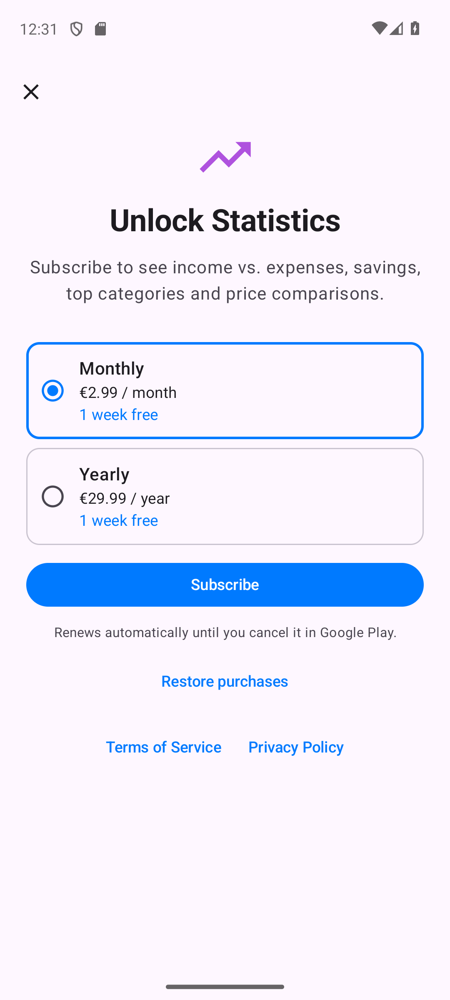

# Ledger for Android: status and next steps

For the iOS developer. Updated 23 November 2026, and kept up to date with each Android pull request.

## Summary

The Android app matches iOS `main` as of 10 November (commit `1748a53`, version 1.0), apart from Siri, which has no
Android equivalent for now (D3). It isn't on Google Play yet.

The Pro subscription is in, but it can only be tested with real purchases and released once a Google Play Console
account exists. [Play Console setup](#play-console-setup) lists what that takes; it's the main thing we need from
you.

How the two apps differ, and why, is in [platform-decisions.md](platform-decisions.md).

## What's done

Everything below is merged into Android `main`, newest first. The D numbers are the decisions we made together on
10 November.

| Merged | What | From | Pull request |
| --- | --- | --- | --- |
| 23 Nov | Version 1.0, the same as iOS | D7, iOS `fa64623` | #13 |
| 23 Nov | Ledger Pro: the paywall and the locked statistics; real purchases wait for the Play Console | D1 | #12 |
| 22 Nov | A photo or PDF shared into the app is saved with the transaction, like scanned pages | iOS `1748a53` | #11 |
| 22 Nov | Home screen widgets: month chart, budget, last three transactions. With the app lock on, they show no amounts or notes. | D4, D5 | #10 |
| 10 Nov | Per-app language (English, Croatian, Ukrainian, Polish) | D8 | #9 |
| 10 Nov | Exact alarms for planned transactions and the daily reminder. On a real idle phone, the alarm fired 1.5 s after the planned time. | D10 | #8 |
| 10 Nov | App lock: no re-lock after the app's own system pages; no amounts in notifications on the lock screen | D5 | #7 |
| 10 Nov | Android backup and phone-to-phone transfer | D2 | #6 |
| 10 Nov | App ID `work.spyglee.ledger`, the same as iOS | D6 | #5 |
| 10 Nov | CSV for all data, editing receipt items, budget alerts once a month, quick actions, Polish, the new icon | iOS `8a76b5d` | #3 |
| 10 Nov | Budgets, receipt items and photos, price comparison, Sources renamed to Accounts | iOS `46702e5` | #2 |
| until 21 Oct | Everything up to planned transactions and list search | iOS up to `f909b82` | earlier |

All 197 unit tests and 43 instrumented tests pass on an emulator. Earlier builds also ran on a real phone with
Android 17.

## Pro subscription

The Android code for Ledger Pro is written, tested and merged (#12). Only the tests with real Google Play purchases
wait for the Play Console.

**Ready, the same as iOS:**

- The same two products, prices and 1-week trial.
- The four statistics screens locked, with a lock icon on each row.
- Restore purchases, and the terms and privacy links.

**Ready, Android's own:**

- **A paywall screen.** Android has nothing like Apple's ready-made subscription store, so the paywall is built from
  the iOS icon, title and text.
- **A stand-in store in debug builds**, like `Ledger.storekit`. It sells the same products, so the paywall can be
  tried without the Play Console.
- **A "Manage subscription" row in Settings**, which opens Google Play.
- **Purchase checking.** Purchases are checked against Google Play's signature with the app's licence key from the
  Play Console. That's the Android counterpart of StoreKit's verified transactions.
- **The last Pro status is remembered** (D1), so the statistics don't look locked while the check runs.

The Android paywall in a debug build, with the stand-in store's prices:

**Tested:**

- 197 unit tests and 43 instrumented tests pass on an emulator, and the billing code had a separate review.
- Buying, failing and restoring with the stand-in store all work.
- A release build reaches Google Play and fails cleanly when Play can't sell yet.

**One finding to confirm together.** In D1 we accepted giving the app internet access, because we believed Play
Billing needs it. Play Billing Library 9.1 doesn't: only Google's usage logging inside it asks for internet, the
same logging we already block for ML Kit. Purchases go through the Play Store app, which does the network part. So
Android still has **no internet permission**, and the "no internet" promise holds on both platforms. The first real
test purchase will confirm it. If it fails, Android goes back to D1 as agreed.

**One difference:** iOS can switch between monthly and yearly inside the app, within its subscription group. On
Android, the user cancels in Google Play and subscribes to the other plan once the first ends. In-app switching can
be added later if you want it.

## Play Console setup

The setup itself takes about a day. A new personal account then needs 14 days of closed testing before the first
public release, so it's worth starting soon. Android can test Pro once steps 1–7 are done.

1. **Create the Google Play developer account.** There's a one-time US$25 fee, and Google may ask for a government
   ID and a card in the owner's legal name ([Google](https://support.google.com/googleplay/android-developer/answer/6112435)).
   - *Personal* account: for individual developers.
   - *Organization* account: for a company. It needs a D-U-N-S number, which is free from Dun & Bradstreet
     ([Google](https://support.google.com/googleplay/android-developer/answer/13634885)).
   - The seller should probably be the same person or company as on the App Store.
2. **Set up a payments profile and link it to the account.** It's needed to sell subscriptions
   ([Android docs](https://developer.android.com/google/play/billing/getting-ready)).
3. **Invite the Android developer** under *Users and permissions*, with rights to manage releases, products and
   testing.
4. **Create the app.** The type is *App*, and it's *Free* with in-app purchases. The package name
   `work.spyglee.ledger` is fixed for good once the first build is uploaded.
5. **Upload a first build to internal testing.** Android provides it as a signed `.aab`; Google Play signs the final
   app itself. After that, Android needs the app's licence key from *Monetize with Play → Monetization setup*,
   because release builds refuse purchases without it. Play Console only offers subscriptions after a build that
   includes Google Play Billing is uploaded
   ([Android docs](https://developer.android.com/google/play/billing/getting-ready)).
6. **Create the two subscriptions** under *Monetize with Play → Products → Subscriptions*
   ([Google](https://support.google.com/googleplay/android-developer/answer/140504)):
   - `work.spyglee.ledger.pro.monthly`: an auto-renewing monthly base plan at €2.99, plus a free-trial offer of 1
     week for new customers.
   - `work.spyglee.ledger.pro.yearly`: a yearly base plan at €29.99, with the same 1-week trial.
   - Product IDs can never be changed or reused, so copy them exactly. Base plan and offer IDs can be anything;
     Android doesn't depend on them.
   - Activate the base plans and the offers. Prices in other countries should match the App Store where possible.
7. **Add license testers** under *Settings → License testing*: your Google account, the Android developer's, and
   anyone else testing. Their purchases are free. A trial lasts 3 minutes, a month renews every 5 minutes and a year
   every 30, up to six renewals ([Android docs](https://developer.android.com/google/play/billing/test)).
8. **Fill in *App content*.**
   - The privacy policy link.
   - Data safety: the answers are drafted in Android's [RELEASE.md](RELEASE.md). No data is collected, and the only
     network use is Google Play billing.
   - The financial features declaration. Ledger offers none of the listed features (banking, loans, payments,
     trading), and even apps with none must fill it in
     ([Google](https://support.google.com/googleplay/android-developer/answer/13849271)).
   - The content rating, target audience and ads (none).
9. **Store listing:** the description, screenshots and a 1024 × 500 feature graphic. The 512 × 512 icon is ready.
   The text can follow the App Store listing.
10. **Closed test.** A personal account created after 13 November 2023 needs at least 12 testers, opted in for 14
    days in a row, before it can apply for production on the Dashboard
    ([Google](https://support.google.com/googleplay/android-developer/answer/14151465)).
11. **Production release.**

The Android app already meets Google's other current rules. It targets Android 16 (API 36), which new apps need from
31 August 2026 ([Android docs](https://developer.android.com/google/play/requirements/target-sdk)). It uses Play
Billing Library 9.1, which is supported until August 2028
([Android docs](https://developer.android.com/google/play/billing/deprecation-faq)).

## Before the iOS App Store release

Some things are cheaper to settle before iOS ships, because they get harder to change once both stores have users.
Most come from the decisions doc and [ios-issues.md](ios-issues.md).

- [ ] **Subscription products stay identical on both stores.** Android uses the iOS IDs
  `work.spyglee.ledger.pro.monthly` (€2.99) and `work.spyglee.ledger.pro.yearly` (€29.99), each with a 1-week free
  trial. If App Store Connect prices or trials change, tell Android.
- [ ] **Terms and privacy pages cover Android too.** `spyglee.work/ledger/terms/` and `spyglee.work/ledger/privacy/`
  should mention Google Play. Google Play requires a privacy policy link for the listing.
- [ ] **Widgets with the app lock on (#16).** iOS widgets still show the balance, budget and transactions while the
  app is locked. Android shows no amounts or notes: a lock instead of the balance, the budget's name and bar only,
  transactions without amount and note. The two should match before release.
- [ ] **Visible iOS issues still open:** the dark-mode lock screen lets balances show through (#1), and the "blance"
  typo (#9).
- [ ] **URL scheme `ladger://` → `ledger://` (D6).** It's simpler to rename it before the first release, together
  with the widget links and the share extension.
- [ ] **Siri logging and the app lock.** Still open: should logging a transaction through Siri check the lock?
- [ ] **Translations (D14).** Android has 43 strings of its own, 16 of them for Pro, listed in
  [translations-to-review.md](translations-to-review.md). They were translated without a native speaker; please send
  them to the translators with the iOS strings.
- [x] **Version numbers (D7).** Android takes the iOS version of the commit it's synced to: both are 1.0. Build
  numbers are separate. When iOS moves to a new version, please say so in the commit.

## Next steps on Android

The order follows [decisions-plan.md](decisions-plan.md). Steps 2–4 don't need the Play Console, so they can go
ahead while it's being set up.

1. **Pro subscription (D1).** Real purchases and the release wait for the Play Console.
2. **Multi-page camera scans (D9).** The Android camera takes one photo per scan, while iOS's document scanner takes
   several pages. Shared PDFs already give several pages.
3. **Cyrillic text recognition (D9).** Android's on-device OCR reads Latin letters only, so Ukrainian words on
   receipts are lost, though amounts and dates are read. We'll build a prototype with Tesseract first, which needs
   real Ukrainian receipts to test with.
4. **CSV spec (D12).** Android drafts `docs/csv-format.md` for you to review and copy to the iOS repo.
5. **First release on Google Play.** Internal testing, then closed testing, then production, in the order
   [Play Console setup](#play-console-setup) describes.

After that, each new iOS commit is ported the same way as before. Smaller iOS commits, each with a few lines on what
behaviour changed (D14), make that much quicker.
